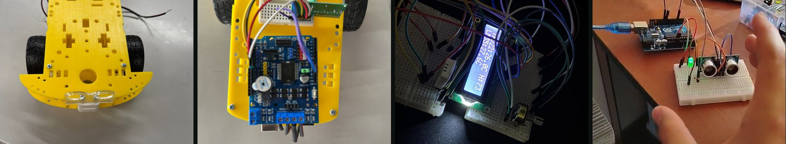

# Laboratorios de Computación Ubicua

**Proyectos con Arduino y C++: sensores, actuadores, un robot móvil y un control de acceso con tarjetas RFID.**

## Proyecto final: control de acceso con RFID

Un lector **RFID MFRC522** compara la tarjeta con una lista de tarjetas autorizadas. Si es válida, enciende el LED verde y activa un **motor** durante 5 segundos a través de un transistor **TIP120** con control PWM. Si no lo es, se enciende el LED rojo. Mientras espera, el LED azul parpadea sin bloquear el programa (uso de `millis()` en vez de `delay()`).

[Código](TRABAJO_PROYECTO_FINAL_COMPLETADO/CODIGO_FUNCIONAMIENTO_DEL_CODIGO_RFID/CODIGO_FUNCIONAMIENTO_DEL_CODIGO_RFID.ino) · [Video del paso a paso](https://www.youtube.com/watch?v=429Tt-C3h7E)

## Laboratorios

| # | Laboratorio | Qué aprendí | Código |
|---|---|---|---|
| 0 | LED que parpadea | Salidas digitales, estructura `setup()` / `loop()` | [ver](Laboratorio__0) |
| 1 | Pulsador y LED | Entradas digitales y resistencias pull-down | [ver](Lboratorio%231) |
| 2 | Lectura analógica | Entradas analógicas para controlar un LED | [ver](Laboratorio%232) |
| 4 | Sensor de distancia ultrasónico | Medir distancia con TRIG/ECHO y reaccionar con un LED | [ver](Lanoratorio%234) |
| Reto | Temperatura con DHT22 y LM35 en pantalla LCD | Comparar dos sensores, promediar lecturas y mostrar datos en un LCD | [ver](RETO_(DTH11_LM35)%2BLED) |
| Robot 1–2 | Multi-bot con puente H (L298P) | Controlar dos motores DC: avanzar, girar y frenar | [ver](MULTI_BOT_IMG%2BCODIGO_VIDEO%232_PUENTE_H) |
| Robot 3 | Multi-bot con RFID | Activar el robot solo con una tarjeta autorizada | [ver](MULTI_BOT_IMG%2BCODIGO_VIDEO%233) |

Los circuitos de los primeros laboratorios están simulados en **Tinkercad** (enlaces `.url` dentro de cada carpeta).

## Cómo probarlos

1. Abre el archivo `.ino` en el **Arduino IDE**.
2. Instala las librerías que pida el sketch desde *Herramientas → Administrar bibliotecas* (`MFRC522`, `DHT sensor library`, `LiquidCrystal`).
3. Conecta la placa Arduino UNO y dale a **Subir**.

---

Materia Computación Ubicua · Ingeniería de Software, Universidad Cooperativa de Colombia · **Luis Miguel Muñoz Rendón** · [Portafolio](https://luism7p7.github.io)
